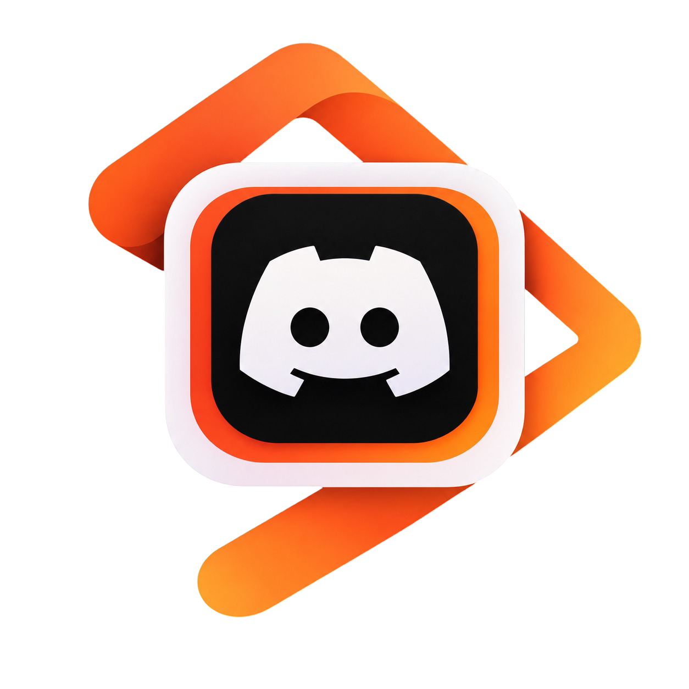

  

<h1 align="center">OpenIDEA Discord Rich Presence</h1>

  A fast, lightweight, and privacy-conscious Discord Rich Presence plugin for <a href="https://github.com/l0ng-ai/openidea">OpenIDEA</a>. Automatically displays your active project, file details, language icons, Git branch, and elapsed session timer on your Discord profile.

  
  
  
  

---

## Features

- **Event-Driven & Instant Sync:** Updates presence seamlessly on editor focus, file navigation, VCS branch changes, and IDE settings adjustments.
- **Ultra-Lightweight Footprint:** Native sidecar daemon consumes only **~5 MB of RAM** with **0.0% idle CPU**.
- **Exhaustive Language & File Recognition:** Parity with 250+ language definitions covering over **475 file extensions** (including composite extensions like `.tar.gz`, `.ng.html`, `.component.ts`, `.spec.js`) and **105 exact file manifests** (`Dockerfile`, `Cargo.toml`, `Makefile`, etc.).
- **6 Rich Icon Themes:**
  - **Material** (default)
  - **Classic**
  - **Atom**
  - **Catppuccin Mocha**
  - **Catppuccin Latte**
  - **Flat**
- **Interactive Status Bar Widget:** Toggle presence with 1-click directly from OpenIDEA's bottom bar (`● Discord` / `○ Discord (Paused)`).
- **Customizable Presence Content:** Choose custom line formats for active files and projects, toggle "Editing " prefixes, and pick between project time, file open time, or no timer.
- **Inactivity & AFK Detection:** Automatically transitions presence to idle or hides presence after a configurable inactivity threshold.
- **Privacy & Security First:**
  - **Privacy Mode:** Completely hides file, project, and branch names from Discord with a single toggle.
  - **Sensitive File Protection:** Automatic sanitization of `.env`, private keys, secrets, and credential files.
  - **Optional Buttons:** Choose whether to expose your public Git repository or IDE download link on Discord.

---

## Capabilities & Permissions

In compliance with OpenIDEA's extension security model, this plugin requests the following capabilities in `plugin.toml`:

| Capability | Purpose |
| --- | --- |
| `project.read` | Reads the current project root path to detect project names and determine Git repository status. |
| `editor.read` | Reads the active file path to determine file names, language icons, and editing status. |
| `events` | Subscribes to IDE lifecycle events (`editor-focused`, `file-opened`, `vcs-changed`, `settings-changed`) for reactive presence updates. |
| `process:openidea-discord-rpc-daemon` | **High-Risk Process Execution:** Launches the native background sidecar daemon bundled in `bin/`. The daemon connects to the local Discord desktop client via local Unix domain sockets (IPC), calculates AFK idle timers, and renders Rich Presence payloads. The daemon makes **no outbound network requests** (all icon assets are hosted via Discord's public CDN). |

---

## Configuration

Access settings anytime in OpenIDEA under **Settings › Plugins › Discord Rich Presence**:

- **General:**
  - `Enable Rich Presence`: Global master toggle.
  - `Detect Inactivity (AFK)`: Automatically updates presence when away from the keyboard.
  - `Inactivity Timeout (Minutes)`: Minutes before entering idle state (default: `5`).
  - `Status When Inactive`: Choose between `Show Idling`, `Keep Current Status`, or `Hide Presence`.
  - `Reset Timer on Return`: Reset session timer upon returning from idle.
- **Presence Content:**
  - `Main Line (File Active)`: Choose `{project} ({branch})`, `{project}`, `{file}`, or empty.
  - `Secondary Line (File Active)`: Choose `Editing {file}`, `{file}`, `{project}`, or empty.
  - `Prefix Files with 'Editing'`: Toggle prepending "Editing " to file names.
  - `Elapsed Time Counter`: Display `Project Time`, `File Open Time`, or `None`.
- **Appearance & Themes:**
  - `IDE Badge Icon Theme`: Theme for the OpenIDEA badge icon.
  - `File Language Icon Theme`: Theme for programming languages and file extensions.
- **Privacy & Buttons:**
  - `Privacy Mode`: Obfuscates file names and projects entirely.
  - `Show 'View Repository' Button`: Links your Discord status to your GitHub/GitLab repository.
  - `Show 'Get OpenIDEA' Button`: Adds a button linking to OpenIDEA.

---

## Commands & Shortcuts

OpenIDEA Command Palette (`Ctrl+Shift+P` / `Cmd+Shift+P`):

- **Discord RPC: Toggle Presence** (`discord-rpc.toggle`): Pause or resume presence instantly (also accessible by clicking the status bar item).
- **Discord RPC: Reconnect** (`discord-rpc.reconnect`): Force reconnection to Discord IPC socket.

---

## Issues & Contributing

Found a bug, having connection issues, or want support for a new programming language or icon theme?

- **Bug Reports:** Open an issue using our [Bug Report template](https://github.com/MathCunha16/OpenIDEA-Discord-RCP/issues/new?template=bug_report.yml) (please include your daemon logs).
- **Feature Requests:** Suggest new languages, themes, or capabilities via the [Feature Request template](https://github.com/MathCunha16/OpenIDEA-Discord-RCP/issues/new?template=feature_request.yml).
- **Contributions:** Check out our [Contributing Guidelines](CONTRIBUTING.md) to learn how to build, test, and submit pull requests.

---

## Acknowledgements

- Icon themes and language definition mappings inspired by the community work in the [JetBrains Discord Integration](https://github.com/Azn9/JetBrains-Discord-Integration) ecosystem.

---

## License

This project is licensed under the [Apache License 2.0](LICENSE).

---

Made with ❤️ by [**Matheus Cunha**](https://github.com/MathCunha16)

⭐ **If you find this project useful, please consider leaving a star on GitHub!**  
Your support helps keep the project active, motivates continued maintenance, and ensures new features and language icons keep coming!

